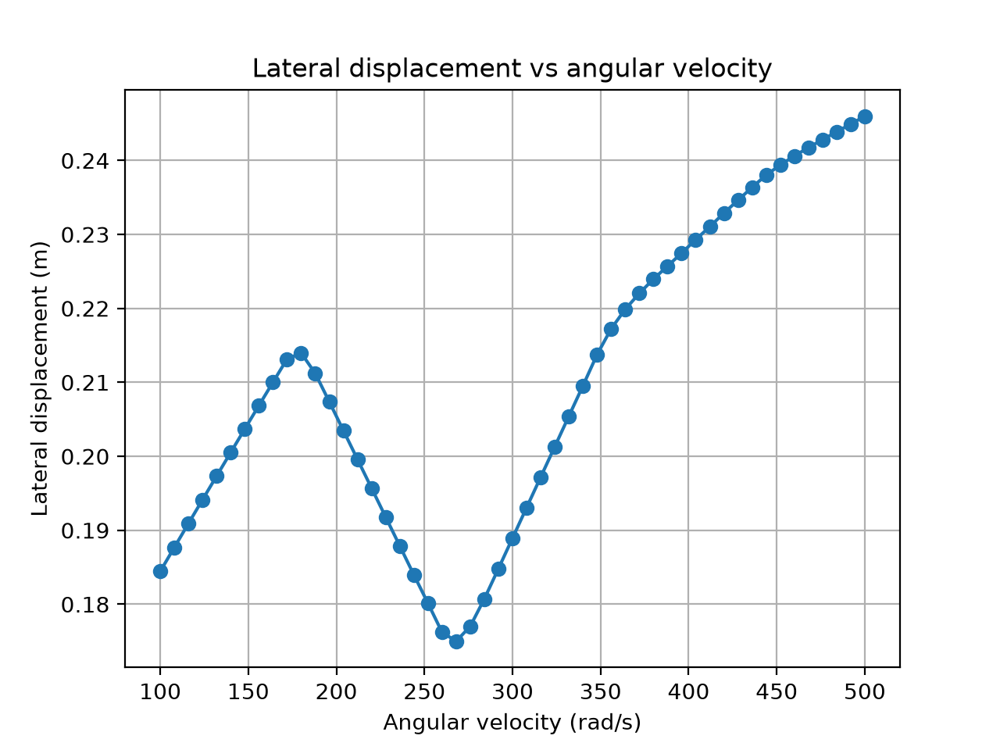

# Magnus Effect Simulation for a Spinning Table Tennis Ball

This is a python simulation I wrote for my IB Physics Extended Essay. It models how the angular velocity ω of a horizontally launched table tennis ball affects its lateral (sideways) displacement due to the Magnus Effect

## Research question: 
How does the angular velocity of a spinning table tennis ball, launched horizontally, affect its lateral displacement?

## Method
- Forces: Gravity, Aerodynamic drag, and the Magnus force
- Numerical integration with the Euler method using time step of dt = 0.0001s.
- Drag and lift coefficients are interpolated as functions of the spin parameter S = rω/v, using a published experimental data from Ito and Kamijima that has a Reynolds number = 13,000. So if you want to put in your own values, you need an independent spin parameter value and its resulting drag&lift coefficient values to put in S_points, Cd_points, and Cl_points.
- To test different omega values, change omega_values = np.linspace(100,500,51) = (initial value, ending value, how many spaces)
- Initial conditions: launch speed 5 m/s in x direction (as it produces a Reynolds number of 12,886, close to Ito and Kamijima's dataset), launch height = 1.0m, only sidespin about the vertical axis. The ball properties I used were from the ITTF official regulation value and the air density & kinematic viscosity was calculated from Engineering Toolbox.
- Output: lateral displacement when the ball reaches the ground for ω = 100~500 rad/s (51 values)

## Results

## How to run
'''
pip install -r requirements.txt
python magnus_simulation.py
'''

The script prints the Reynolds number check for different speeds and the resulting table and saves the graph as 'lateral_displacement_plot.png', also showing the plot.

## Limitations:
- Only sidespin about one axis is modelled: no other spin axis were included
- Spin is assumed constant during flight
- The drag & lift coefficients are from published experimental data, not my own, so features of the results may come from the data itself rather than being independent evidence
- The model is simplified: no air currents, no table, net, or interaction

## Reference
"Air Density, Specific Weight, and Thermal Expansion Coefficients at Varying Temperatures and Pressures." The Engineering ToolBox, www.engineeringtoolbox.com/air-density-specific-weight-d_600.html?vA=25&units=C#. Accessed 26 Sept. 2026.
"Air Viscosity: Dynamic and Kinematic Viscosity at Various Temperatures and Pressures." The Engineering ToolBox, www.engineeringtoolbox.com/air-absolute-kinematic-viscosity-d_601.html. Accessed 26 Sept. 2026.
Ito, Kenichi, and Kei Kamijima. "Estimation of Aerodynamic Properties of a Spinning Table Tennis Ball Using Computational Fluid Dynamics Analysis." Transaction of the Japan Society for Simulation Technology, vol. 17, no. 1, 2025, pp. 25-31, doi.org/10.11308/tjsst.17.25. 
"The International Table Tennis Federation Statutes 2026." International Table Tennis Federation, 54th ed., 1 Jan. 2026, documents.ittf.sport/sites/default/files/public/2026-02/2026_Statutes_v1_consolidated_clean.pdf. Accessed 26 Sept. 2026.

## Context
Written for my IB Diploma Extended Essay in Physics
 
